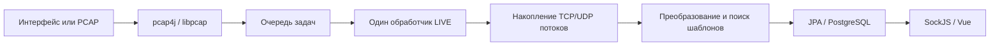
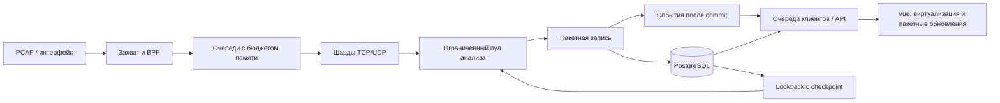

# План переноса Packmate на Go и проверки под нагрузкой A/D CTF

Дата анализа: 14 ноября 2026 года.

Цель: переписать бэкенд Packmate на Go, сохранить узнаваемый интерфейс и основные сценарии работы, улучшить устойчивость при большом объёме трафика. Изменения фронтенда разрешены: в первую очередь исправления совместимости и производительности.

Исходный масштаб от пользователя: примерно 50 команд по 4 человека, каждый участник может отправлять трафик в анализируемые сервисы. Это до 200 логических источников нагрузки; число соединений и запросов определяется их автоматизацией и может быть значительно больше.

Уточнённые условия: анализатор и игровые сервисы работают на одной машине с 8 ядрами и 16 ГБ RAM; сервисы обычно размещены в Docker; рабочий режим всегда LIVE; основные протоколы — HTTP и произвольный TCP, возможен gRPC. Наблюдавшийся отказ: после длительной работы новые сессии переставали появляться, восстановление требовало перезапуска контейнера. Главные критерии переноса — непрерывность анализа и сохранение ресурсов для игровых сервисов.

Документ основан на чтении исходников трёх репозиториев. Приложение и нагрузочные тесты в рамках составления плана не запускались. Описанные риски выявлены статическим анализом; их вклад в реальные задержки предстоит измерить. Числа производительности ниже — цели и параметры экспериментов, а не полученные результаты.

Статус после начала реализации: первый рабочий LIVE-прототип и короткие локальные проверки описаны в [reports/INITIAL.md](reports/INITIAL.md); ограничения — в [README.md](README.md). По дополнительному разрешению пользователя подготовлен удалённый стенд Kali с отдельными HTTP/TCP/gRPC-контейнерами: [deploy/kali/README.md](deploy/kali/README.md). Эти промежуточные результаты не означают выполнения всех этапов и критериев ниже.

Обновление реализации: перенесены декодеры HTTP/gzip/URL/WebSocket и HTTP/2/gRPC, поиск через raw-блоки, lookback с checkpoint, импорт Java-БД, виртуализация UI и динамический BPF. Результаты и оставшиеся границы — [reports/FEATURES.md](reports/FEATURES.md). Это функциональное обновление, а не выполнение шестичасовой приёмки или доказательство ускорения относительно Java.

## 1. Исходная система и границы анализа

| Репозиторий | Изученная ревизия | Назначение |
| --- | --- | --- |
| [Packmate](https://gitlab.com/packmate/Packmate) | `938031f1dedfbedabef5b049368ed5b6ba6a900a` | Java 17, Spring Boot 3.0.6, pcap4j/libpcap, JPA/Hibernate, PostgreSQL |
| [packmate-frontend](https://gitlab.com/packmate/packmate-frontend) | `a15d846d37b03e82b243517c594a53895121cc84` | Vue 2, BootstrapVue, Axios, SockJS, Vuex, IndexedDB |
| [starter](https://gitlab.com/packmate/starter) | `25a2517dceb567a1571cd3666cfaadee0b66779b` | Docker Compose, PostgreSQL, настройки захвата |

Бэкенд закрепляет frontend-submodule на `8f23d97100f11cd6671bb62aca5ce9b6a898b865`. Эта ревизия дополнительно получена и сравнена с frontend HEAD: в HEAD удалены элементы настройки и отображения TLS. Зафиксировать закреплённую пару как исходную версию для тестов, изменения интерфейса вести отдельными коммитами.

Текущий путь данных:



Обязательный рабочий режим — `LIVE`. Чтение PCAP сохранить как инструмент воспроизведения ошибок и тестирования общего конвейера; отдельные пользовательские режимы FILE/VIEW не являются условием первого выпуска. Сохранить TCP/UDP и направление трафика; сервисы по портам; списки потоков и пакетов; избранное; текстовый и hex-просмотр; поиск строк, байтов и регулярных выражений; FIND/IGNORE; lookback; HTTP/gzip, URL decode, WebSocket-разбор; настройки, счётчики и уведомления. HTTP/2 и gRPC включить в обязательную матрицу анализа. Поддержку legacy TLS вынести за критический путь первого LIVE-релиза; до реализации явно показывать, что содержимое TLS не расшифровано.

## 2. Что в текущем коде требует внимания

### 2.1. Очередь без верхней границы и последовательная обработка

В [LivePcapWorker.java](https://gitlab.com/packmate/Packmate/-/blob/938031f1dedfbedabef5b049368ed5b6ba6a900a/src/main/java/ru/serega6531/packmate/pcap/LivePcapWorker.java) используется `ThreadPoolExecutor(1, 1, ..., new LinkedBlockingQueue<>())`. В [AbstractPcapWorker.java](https://gitlab.com/packmate/Packmate/-/blob/938031f1dedfbedabef5b049368ed5b6ba6a900a/src/main/java/ru/serega6531/packmate/pcap/AbstractPcapWorker.java) пакеты передаются туда отдельными задачами, а закрытие потока вызывает `saveNewStream` в том же обработчике.

Следствие по структуре кода: если обработка и сохранение медленнее поступления пакетов, растут очередь, расход памяти и задержка. Увеличение числа потоков без изменения владения состоянием небезопасно: текущие коллекции потоков рассчитаны на последовательный доступ.

**Изменение:** распределять соединения между ограниченным числом обработчиков по симметричному ключу потока; отделить захват, анализ, запись и уведомления; ограничивать очереди одновременно по элементам и байтам.

### 2.2. Активные потоки целиком остаются в памяти

TCP/UDP-пакеты хранятся в multimap до закрытия или таймаута. В проверенном обработчике нет бюджета размера одного потока и общей памяти. Idle timeout не ограничивает постоянно активное соединение. Проверка таймаутов перебирает активные потоки и также сохраняет их через общий обработчик.

**Изменение:** лимиты числа потоков, байтов на поток, reassembly-буферов и максимального возраста; инкрементальная обработка; сохранение частей долгих потоков; TTL-структура вместо обязательного полного сканирования. Любое усечение или разрыв отмечать в данных и интерфейсе.

### 2.3. Сборка TCP не учитывает sequence numbers

В показанном пути обработки используются флаги ACK/FIN/RST и добавление payload в порядке получения, но не TCP sequence numbers. [PacketsMerger.java](https://gitlab.com/packmate/Packmate/-/blob/938031f1dedfbedabef5b049368ed5b6ba6a900a/src/main/java/ru/serega6531/packmate/service/optimization/PacketsMerger.java) склеивает соседние пакеты одного направления. При retransmit, reordering и пропусках это создаёт риск неверного содержимого и результатов поиска.

**Изменение:** полноценная ограниченная по памяти TCP reassembly, политика перекрытий и пропусков, поддержка захвата с середины соединения и повторного использования портов. Исходные пакеты и восстановленный поток должны быть различимы. Исправленные результаты проверять по независимому эталону, а не копировать ошибки Java-версии.

### 2.4. Запись, lookback и очистка конкурируют за ресурсы

[StreamService.java](https://gitlab.com/packmate/Packmate/-/blob/938031f1dedfbedabef5b049368ed5b6ba6a900a/src/main/java/ru/serega6531/packmate/service/StreamService.java) запускает оптимизации, поиск и сохранение одного графа объектов. Hibernate batching уже включён с размером 20: нельзя считать исходную версию полностью лишённой пакетной записи. Lookback получает весь выбранный диапазон через `findAll`, затем проходит по потокам в одной транзакции.

[StreamRepository.java](https://gitlab.com/packmate/Packmate/-/blob/938031f1dedfbedabef5b049368ed5b6ba6a900a/src/main/java/ru/serega6531/packmate/repository/StreamRepository.java) совмещает pagination с `JOIN FETCH` коллекции совпадений; проверить фактический SQL, предупреждения Hibernate и объём выборки. Список потоков уже использует `startingFrom`, поэтому переход с OFFSET нельзя заявлять как новое улучшение.

**Изменение:** пакетная запись завершённых результатов, короткие транзакции, постраничный lookback с checkpoint, ограничение фоновой работы, индексы под реальные фильтры. План выполнения запросов и стоимость очистки подтвердить на БД с объёмом данных за игру.

### 2.5. Поиск шаблонов имеет риски стоимости и конкурентного доступа

[PatternMatcher.java](https://gitlab.com/packmate/Packmate/-/blob/938031f1dedfbedabef5b049368ed5b6ba6a900a/src/main/java/ru/serega6531/packmate/service/PatternMatcher.java) использует общие `HashMap` и кеширует изменяемые KMP-поисковики. Lookback может выполняться одновременно с live-анализом. Фильтрация списка шаблонов повторяется для payload; текст создаётся и для бинарного поиска. Цикл regex обновляет позицию на `matcher.end()`: совпадение нулевой длины может оставить её неизменной.

**Изменение:** неизменяемые версии наборов шаблонов, локальное состояние поиска, предварительная группировка по сервису/направлению/действию, ограничение числа совпадений. Обязательны тесты пустых совпадений, пересечений, бинарных данных и одновременного изменения шаблонов.

### 2.6. Рассылка событий и браузер могут стать отдельным пределом

[SubscriptionService.java](https://gitlab.com/packmate/Packmate/-/blob/938031f1dedfbedabef5b049368ed5b6ba6a900a/src/main/java/ru/serega6531/packmate/service/SubscriptionService.java) последовательно вызывает отправку всем подписчикам; один из случаев переполнения обрабатывается без восстановления сообщения. Фактическую степень блокировки транспорта нужно измерить.

[Sidebar.vue](https://gitlab.com/packmate/packmate-frontend/-/blob/a15d846d37b03e82b243517c594a53895121cc84/src/components/Sidebar.vue) добавляет каждый новый поток через `unshift` без ограничения списка. Есть несоответствие: live-фильтр обращается к `stream.foundPatterns`, а DTO бэкенда содержит `foundPatternsIds`. [App.vue](https://gitlab.com/packmate/packmate-frontend/-/blob/a15d846d37b03e82b243517c594a53895121cc84/src/App.vue) переподключается к SockJS, но не содержит полноценного протокола восстановления пропущенных событий.

**Изменение:** очереди на клиента, пакетные события, подписки на фильтры, восстановление через cursor/snapshot, виртуализированный ограниченный список. Проверять скорость отображения отдельно от скорости приёма трафика.

### 2.7. Приоритетный отказ: новые сессии перестают появляться

По наблюдению пользователя, после длительной работы Packmate зависал до перезапуска контейнера. Этот симптом не доказывает конкретную причину. Проверить независимо: рост неограниченной очереди и GC, зависание regex/декодера, блокировку записи/пула БД, прекращение чтения capture, потерю событий и зависание браузера. Отдельно проверить ожидание завершения долгоживущего TCP-соединения: оно может задерживать отображение без остановки всего процесса.

В baseline-тесте при проявлении симптома сначала автоматически собрать ограниченный по размеру диагностический пакет: несколько thread dumps с интервалом, CPU/GC/heap counters, очереди, состояние capture, активные запросы и ожидания PostgreSQL, cgroup throttling/OOM/pressure, прогресс commit, API и event-транспорта. Heap dump делать только при достаточном запасе диска и вне боевой машины. Сверить наличие новых строк в БД, их доступность через API и отображение в браузере, чтобы локализовать остановившийся этап до ребута.

В тестовой сети отправлять короткий известный marker-запрос каждые 5 секунд и отслеживать его путь до UI. На штатной нагрузке отсутствие результата более 15 секунд считать отказом теста и поводом собрать диагностику. Сам факт ответа `/health` не подтверждает работу анализатора.

## 3. Целевая архитектура

Начать с одного Go-приложения и PostgreSQL, с чёткими внутренними границами. Отдельные брокеры и дополнительные СУБД добавлять только по результатам измерений. Первый релиз должен оставаться удобным для запуска одной командой через Compose.



### 3.1. Захват и управление потоками

- Базовый адаптер: libpcap для LIVE и чтение PCAP для FILE. На Linux сравнить с `AF_PACKET`/`TPACKET_V3`; выбирать по измеренным pps, CPU и потерям, а не обещать ускорение заранее.
- Проверить кандидата `github.com/gopacket/gopacket` для decode/reassembly/capture, зафиксировать версию и поддерживаемые link types. Включить Ethernet, VLAN, Linux cooked capture, IPv4/IPv6; IPv4/IPv6-фрагментацию либо поддержать с лимитами, либо явно учитывать как неподдержанную.
- Потоки направлять по нормализованному двунаправленному ключу: адреса, порты, протокол, контекст интерфейса/VLAN. Состоянием соединения владеет один обработчик. Разные соединения обрабатываются параллельно; порядок внутри соединения сохраняется.
- Число goroutine зависит от настроенного числа работников, а не от числа пакетов. CPU-пулы захвата, анализа и фоновых задач имеют отдельные лимиты.
- Не передавать в очередь срезы памяти capture ring после освобождения/повторного использования. Контракт zero-copy API требует учитывать срок жизни буфера; копировать нужные данные или передавать корректное владение. [Документация afpacket](https://pkg.go.dev/github.com/gopacket/gopacket/afpacket).
- Таймауты LIVE считать по монотонному времени. FILE обрабатывать по временным меткам записи, с корректным завершением на EOF. Повторный импорт не должен склеивать одинаковые tuples разных прогонов.
- Контроль завершения: FIN/RST, idle timeout, максимальная длительность, повторное использование tuple, shutdown. Долгие потоки делать доступными частями, сохраняя общий идентификатор соединения и порядок частей.

Для Docker сначала определить точку захвата по фактической топологии: входящий интерфейс/VPN до NAT — кандидат для внешнего игрового трафика; bridge/veth после NAT — если нужны внутренние обращения или открытый трафик после proxy. Docker поддерживает перенаправление опубликованных портов на порты контейнеров, поэтому адреса и порты зависят от точки наблюдения. [Docker bridge networking](https://docs.docker.com/engine/network/drivers/bridge/).

Для каждого нужного пути выбрать одну каноническую точку наблюдения; не включать захват на всех интерфейсах без проверки дублирования. Проверить обе стороны соединения, published port → container port, несколько Compose-сетей, одинаковые внутренние порты у разных сервисов, host networking, VPN, рестарт контейнера и изменение IP/veth. Модель сервиса должна поддерживать правила сопоставления адреса/порта/интерфейса, сохраняя привычный список сервисов. Для нескольких локальных адресов направление нельзя определять одним сравнением с `LOCAL_IP`. Внутренний east-west трафик включать только для нужных сервисов, исключив собственный API, БД и метрики анализатора.

### 3.2. Перегрузка и бюджеты ресурсов

У каждого этапа должны быть измеримые пределы: очередь в байтах, число активных потоков, размер потока, out-of-order buffer, размер распаковки, число совпадений, время задачи, очередь клиента. Начальные значения выбрать на этапе прототипа и сохранить в конфигурации стенда.

В FILE допустимо замедлять чтение при заполнении очереди. В LIVE приложение не может остановить отправителей: блокировка чтения лишь переносит потери в ядро. При исчерпании бюджета применять описанную политику сброса с отдельным счётчиком причины; поток с пропуском помечать неполным. Не выдавать усечённый payload за полностью восстановленный.

Порядок действий при перегрузке:

1. Приостановить или ограничить lookback, снизить частоту вспомогательных обновлений.
2. Не позволять медленным клиентам занимать память сборщика; переводить их на snapshot/resync.
3. Ограничить дорогостоящие преобразования по бюджету, сохранить исходные данные в пределах квоты, отметить пропущенный анализ.
4. При заполнении ingest-очередей сбрасывать данные по документированной политике, считать потери и показывать состояние перегрузки.

Дисковый spool/кольцевой raw PCAP — отдельная опция, если тесты покажут необходимость переживать остановку БД. Он требует квоты, политики fsync, checkpoint и идемпотентного replay; не считать его безразмерной страховкой. В базовом режиме данные в RAM до commit могут быть потеряны при аварии. Гарантия сохранности начинается после успешного commit; окно потери измеряется отдельно.

**Контроль продвижения обработки.** Для capture, reassembly, анализа, writer и событий вести heartbeat работника, счётчик завершённой работы и возраст старейшей ожидающей задачи. Watchdog должен различать отсутствие входного трафика, активное незавершённое соединение и остановку этапа при наличии работы. Состояние БД и CPU throttling учитывать отдельно. Начальная граница предупреждения — 15 секунд отсутствия ожидаемого прогресса при накопившейся работе; уточнить по тестам и таймаутам.

Запросы БД, ожидание соединения и запись событий имеют deadline; парсеры проверяют бюджет между шагами. Таймаут goroutine сам по себе не прекращает её выполнение: нельзя запускать замену зависшей задаче и бесконечно накапливать старые. Изолировать причину, восстановить доступный этап через ограниченные повторы; непредотвратимые зависания стороннего кода потребуют изоляции процессом или замены библиотеки. Watchdog сохраняет диагностику и переводит readiness/индикатор UI в degraded. Перезапуск всего приложения — ограниченная аварийная мера с backoff и учётом потери RAM-данных, не критерий успешной шестичасовой работы. Idle capture не должен вызывать restart loop.

### 3.3. Анализ содержимого

- Разделить исходные байты и представление после HTTP/gzip/URL/WebSocket-преобразований; сохранять происхождение и причину ошибки. Переключение raw/decoded добавить без изменения основных сценариев просмотра.
- HTTP: split headers/body, keep-alive с несколькими сообщениями, chunked encoding, gzip, частичные/повреждённые сообщения. WebSocket: границы фреймов, fragmentation, masking, permessage-deflate. Ограничить вход, выход распаковки и рабочую память; одного контекстного timeout недостаточно, если парсер его не проверяет.
- Поиск строк и байтов сначала реализовать просто и измерить. При большом количестве литералов сравнить многопаттерновый алгоритм с последовательным поиском. Зафиксировать поиск через границы TCP-сегментов и частей потока.
- Для regex по умолчанию использовать стандартный `regexp`: он гарантирует линейное по входу время для фиксированного выражения. Однако Java-синтаксис совместим не полностью: backreferences/lookaround нужно выявлять при импорте, сообщать о них и покрыть примерами. Не подменять выражения молча. [Документация Go regexp](https://pkg.go.dev/regexp).
- Если обнаружатся необходимые несовместимые выражения, вынести поддержку в отдельное решение: ограниченный по ресурсам процесс либо явное изменение шаблонов. Не подключать неограниченный backtracking к live-пути.
- Текстовые позиции подсветки согласовать с UTF-16 индексами JavaScript, бинарные — с byte offsets. Go-индексы нельзя напрямую считать позициями JS-строки. Проверить emoji, кириллицу, invalid UTF-8, включённую правую границу старого DTO и отображение в hex.
- TLS на последующем этапе: воспроизвести только подтверждённый существующими fixtures набор legacy RSA-возможностей; современный TLS не объявлять расшифрованным по одному RSA-ключу. Определить формат передачи секретов лишь если такая функция понадобится. Незашифрованный и непрочитанный трафик должны различаться в UI с первого выпуска.

### 3.4. HTTP/2 и gRPC

HTTP/2 мультиплексирует RPC внутри одного TCP-соединения. Поэтому выделить транспортное соединение, HTTP/2 stream и отдельное gRPC-сообщение; отображать RPC и завершённые сообщения по мере поступления, не ожидая закрытия TCP. Для streaming RPC сохранять ограниченные части истории с общим RPC ID.

План разбора: preface/SETTINGS, HEADERS/CONTINUATION и HPACK, DATA и длины gRPC-сообщений, trailers/`grpc-status`, RST_STREAM/GOAWAY. Одно сообщение может пересекать границы DATA и TCP-сегментов; один DATA может содержать несколько сообщений. Ограничить размер header list, HPACK table, число активных streams и размер сообщения/распаковки. После потери необходимых байтов или захвата с середины соединения помечать состояние разбора как неполное; не продолжать недостоверное декодирование HPACK. [Спецификация gRPC over HTTP/2](https://github.com/grpc/grpc/blob/master/doc/PROTOCOL-HTTP2.md).

Покрыть unary, client streaming, server streaming и bidirectional streaming. Базовый просмотр — metadata, границы сообщений, raw/hex payload и результаты поиска. При наличии `.proto`/descriptor set добавить декодирование protobuf; без схемы не обещать имена и типы полей. Не делать доступность server reflection условием работы пассивного анализатора. [Модель RPC и сообщений gRPC](https://grpc.io/docs/what-is-grpc/core-concepts/).

Приёмка разбора содержимого сначала на открытом HTTP/2 (h2c). Для gRPC поверх TLS сохранять доступные метаданные транспорта и зашифрованные байты; искать plaintext можно только в точке после существующего TLS-терминатора либо при отдельно реализованной поддержке секретов. Наличие Docker само по себе не делает TLS открытым. Добавить тест, что encrypted/partial/decoded различаются в UI. Legacy RSA-дешифрование не решает этот сценарий.

### 3.5. Хранение и запросы

- Первый вариант: PostgreSQL для настроек, метаданных, payload и совпадений. Сохранить простое развёртывание; размер хранилища оценить до большого прогона.
- Использовать явные SQL-миграции и `pgx`; сравнить batch inserts и `CopyFrom` для потоков, пакетов и совпадений. Транзакция должна атомарно публиковать связанный набор данных; уведомления отправлять после commit. [Документация pgx](https://pkg.go.dev/github.com/jackc/pgx/v5).
- Ограничить размер batch и время ожидания его заполнения: низкая нагрузка не должна приводить к долгому ожиданию появления потока. Разделить бюджет соединений БД для ingest, API и фоновых задач.
- Сохранить keyset pagination: потоки по убыванию ID, пакеты по возрастанию. Не подгружать payload для списка потоков. Проверить индексы `(service_id, id)`, частичный индекс избранного, `(pattern_id, stream_id)`, `(stream_id, id)` и временные фильтры через `EXPLAIN (ANALYZE, BUFFERS)`.
- Lookback читать небольшими страницами до зафиксированной верхней границы; сохранять checkpoint и версию шаблона, выполнять повторно без дублирования matches. Несколько запусков, удаление шаблона и рестарт не должны ломать live-анализ.
- Очистку выполнять ограниченными порциями. Сохранить исключение для избранного. Если нужны временные партиции, отдельно решить хранение избранного: безусловный DROP старой партиции с избранными потоками недопустим.
- Переход payload в сегментные файлы рассматривать только если PostgreSQL ограничивает целевой профиль. До такого перехода спроектировать атомарность, crash recovery, GC, backup и соответствие ссылок БД файлам.
- Для миграции старой БД: пробный импорт на копии, явное отображение ordinal enum, ID/sequences, настроек, избранного, совпадений и payload; сверка количества и хешей. Не изменять единственную исходную БД на месте.

## 4. API и фронтенд

Сохранить Vue-интерфейс, названия основных сущностей, работу с сервисами/шаблонами, сочетания клавиш и просмотр пакетов. Сначала зафиксировать поведение текущей пары frontend/backend; затем отдельно внедрять изменения производительности. Большую смену UI-фреймворка не включать в критический путь переноса.

### 4.1. Контракт совместимости

| Область | Существующие маршруты |
| --- | --- |
| Сервисы | `GET/POST /api/service/`, `POST/DELETE /api/service/{port}` |
| Шаблоны | `GET/POST /api/pattern/`, `POST/DELETE /api/pattern/{id}`, `POST /api/pattern/{id}/enable?enabled=...` |
| Lookback | `POST /api/pattern/{id}/lookback`, тело — число минут |
| Потоки | `POST /api/stream/all`, `POST /api/stream/{port}` |
| Избранное | `POST /api/stream/{id}/favorite`, `POST /api/stream/{id}/unfavorite` |
| Пакеты | `POST /api/packet/{streamId}` |
| Захват | `GET /api/pcap/started`, `POST /api/pcap/start` |
| События | SockJS `/api/ws`, сообщения `{type, value}` |

Источники контракта: [контроллеры](https://gitlab.com/packmate/Packmate/-/tree/938031f1dedfbedabef5b049368ed5b6ba6a900a/src/main/java/ru/serega6531/packmate/controller) и [DTO](https://gitlab.com/packmate/Packmate/-/tree/938031f1dedfbedabef5b049368ed5b6ba6a900a/src/main/java/ru/serega6531/packmate/model/pojo).

Проверить реальные JSON, trailing slash, HTTP-статусы, `null` и пустые массивы, base64 payload, timestamps в миллисекундах, enum, пагинацию и HTTP Basic auth. Сохранить Java-совместимый `userAgentHash`, если он остаётся пользовательским идентификатором. Счётчики текущего UI относятся к минутному интервалу; отделить их от накопительных метрик захвата.

Существующие события: `SAVE_SERVICE`, `DELETE_SERVICE`, `SAVE_PATTERN`, `NEW_STREAM`, `FINISH_LOOKBACK`, `COUNTERS_UPDATE`, `ENABLE_PATTERN`, `DISABLE_PATTERN`, `PCAP_STARTED`, `PCAP_STOPPED`.

SockJS не равен обычному WebSocket. Временный совместимый транспорт должен поддерживать необходимые handshake/fallback сценарии текущего клиента. Для нового фронтенда можно перейти на native WebSocket через версионированный endpoint, например `/api/v2/events`, и убрать SockJS после завершения перехода. Не тратить первый этап на написание полного SockJS-сервера вручную: сначала проверить готовый адаптер или переходный proxy.

### 4.2. Разрешённые изменения фронтенда

- Исправить обращение к `foundPatterns`/`foundPatternsIds` и унифицировать типы ID при сравнении с query parameters.
- Виртуализировать список потоков и большие представления пакетов; держать ограниченное окно, например 1 000–5 000 строк метаданных, а историю подгружать по cursor. Конкретный размер выбрать по browser benchmark.
- Применять обновления пачками, например раз в 100–250 мс, с бюджетом времени на кадр. Счётчики агрегировать отдельно; тяжёлое форматирование больших payload при необходимости вынести в Web Worker.
- Подписываться на выбранный сервис/шаблон и последние записи. Снятие паузы должно запрашивать актуальный snapshot, а не проигрывать бесконечную очередь.
- Добавить event sequence/cursor, дедупликацию, resume и snapshot fallback. При переполнении очереди сервер сообщает необходимость resync; клиент не показывает устаревший список как актуальный.
- Snapshot/resume спроектировать без гонки: snapshot имеет watermark, затем применяются события после watermark. При рестарте сервера или истечении retention событий клиент получает новый snapshot. Для настроек и lookback состояния источником истины остаётся БД.
- Показать задержку анализа, потери захвата, неполные потоки и пропущенные преобразования. Эти данные нужны аналитику для оценки содержимого пакетов.
- Для HTTP/2/gRPC показывать список RPC внутри соединения и поступающие сообщения streaming RPC; поддержать события обновления открытого потока. Пустой список новых TCP-соединений не должен создавать впечатление остановки при активных RPC в существующем соединении.
- Отдельно измерить затраты текущего Vuex persistence и IndexedDB. Не сохранять высокочастотное временное состояние без необходимости; ограничить срок хранения истории счётчиков.
- Зафиксировать воспроизводимую сборку frontend. Корректировки зависимостей и build toolchain делать отдельно от переноса API, с проверкой визуального поведения.

## 5. Модель нагрузки: 50 команд × 4 участника

### 5.1. Что именно моделируется

Основной сценарий по уточнениям пользователя: один Packmate наблюдает Docker-сервисы на общей машине своей команды, на которые приходят атаки остальных команд. Для такого случая реальных внешних команд может быть 49; тест с 200 источниками оставляет небольшой запас. Центральный сбор трафика всех 50 команд в текущий профиль приёмки не входит.

Начальные параметры до получения реальных трасс: 10 сервисов, раунд 60 секунд, игра 6 часов, 200 логических атакующих агентов, отдельный трафик чекеров. Это тестовые допущения, число сервисов и тайминг настраиваются.

Определения:

- `rps_attack = active_agents × requests_per_agent_per_second`, суммарно по всем наблюдаемым сервисам.
- Число сервисов распределяет этот поток; не умножать общий RPS на число сервисов повторно.
- Для модели чекеров: `rps_checker = services × transactions_per_service_per_round / round_seconds`, плюс заданные повторы и всплески. Заранее определить, сколько запросов содержит одна checker-транзакция.
- Для одного запроса на TCP-соединение CPS примерно равен RPS. С keep-alive он меньше; длинные соединения проверять отдельно.
- Для gRPC считать RPC/s, messages/s, bytes/s, активные HTTP/2 streams и TCP connections отдельно. В длительном streaming RPC входящая нагрузка может расти без появления новых RPC или TCP-соединений.
- PPS, бит/с, CPS, активные потоки и новые потоки/с измерять независимо. RPS не описывает стоимость обработки пакетов.

### 5.2. Стартовая матрица

| Профиль | Активные агенты | Запросов/с на агента | Суммарный attack RPS | Назначение |
| --- | ---: | ---: | ---: | --- |
| L0 | 50 | 1 | 50 | Проверка корректности стенда |
| L1 | 200 | 1 | 200 | Умеренная активность всех участников |
| L2 | 200 | 5 | 1 000 | Основной кандидат на профиль приёмки |
| L3 | 200 | 20 | 4 000 | Активная автоматизация атак |
| L4 | 200 | 50 | 10 000 | Поиск предела системы |

В каждой строке дополнительно задаются checker-профиль, размеры запросов/ответов, keep-alive и число пакетов. Это не прогноз поведения конкретного соревнования.

Например, при 4 KiB суммарного прикладного payload на транзакцию L2 даёт около 32,8 Мбит/с payload, L4 — 327,7 Мбит/с; сетевой overhead добавляется отдельно. При 12 захваченных пакетах на транзакцию это 12 и 120 тыс. pps соответственно. Для маленьких пакетов нужен отдельный pps-тест, даже если Мбит/с невелики.

Дополнительные оси:

- Потоки: 1 тыс., 10 тыс., 50 тыс. и 100 тыс. одновременно, включая простаивающие, короткие и долгие соединения; верхние значения служат стресс-тестом лимитов.
- Пакеты: ступени 10/50/100/250/500 тыс. pps с записанным распределением размеров, в пределах физической пропускной способности стенда.
- Шаблоны: 10/100/1 000, разные доли regex/строк/байтов, много совпадений и почти совпадающие строки.
- Аналитики: 4 и 20 одновременных браузеров; 50 и 200 API/event-клиентов как отдельный стресс-профиль. 200 атакующих не означают 200 пользователей интерфейса одного Packmate.
- База: пустая, после одного часа и после полной игры; запросы с попаданием в cache и холодные выборки.
- Трафик: равномерно по сервисам и 80% на один сервис, чтобы проверить перекос распределения работы.
- Протоколы: отдельные HTTP/1.1, raw TCP и gRPC-профили; стартовая смешанная модель — 60/30/10% прикладных транзакций с независимо заданными размерами и частотой сообщений. Для gRPC дополнительно 1/10/100 параллельных RPC на соединение и многочасовые streaming RPC. Эти доли являются параметрами теста, а не наблюдением о соревновании.

### 5.3. Стенд и объём хранения

Основной стенд приёмки: общая Linux-машина с 8 ядрами и 16 ГБ RAM, на которой одновременно работают игровые Docker-сервисы, Go-анализатор и его PostgreSQL. Все 8 ядер и 16 ГБ анализатору не принадлежат. Тип диска и скорость сети пока неизвестны; 1 Гбит/с использовать только как первоначальное допущение лаборатории. Зафиксировать модель CPU, фактические RAM/диск/IOPS/NIC, ядро Linux, MTU, offload-настройки, версии образов и лимиты контейнеров.

Начальный экспериментальный бюджет стека анализа — суммарно до 2 CPU и 4 GiB RAM: Go до 1 CPU / 2 GiB, PostgreSQL до 1 CPU / 2 GiB. Это проверяемая отправная точка, не доказанная достаточность. Лимиты должны реально применяться через cgroups и проверяться на запущенном Compose. Docker без явных ограничений не выделяет такой бюджет автоматически. [Ограничения ресурсов Docker](https://docs.docker.com/engine/containers/resource_constraints/).

Оставшиеся ресурсы предназначены сервисам и ОС; CPU-квота не гарантирует им задержки или отсутствие конкуренции за диск. До выбора бюджета измерить потребление сервисов, системную память и запас под пики. Если свободного запаса нет, уменьшить бюджет анализатора/ретенцию/стоимость обработки и пересмотреть целевой RPS, не урезая игровые сервисы автоматически. Heap, reassembly и очереди должны помещаться ниже container limit с запасом на capture buffers, native memory и прочие расходы; контролировать всю cgroup memory, а не только Go heap.

Сравнить три режима на одинаковой игровой нагрузке: сервисы без анализатора, с Java и с Go. Java/Go получать одинаковый суммарный бюджет приложения и БД; если Java не запускается в этом бюджете, зафиксировать факт и отдельно измерить её минимально рабочий профиль. Контролировать latency и checker-успех сервисов, CPU throttling, memory/IO pressure и диск. Результат на выделенном мощном сервере не заменяет приёмку на общей машине.

Генераторы атак/чекеров и браузеры размещать вне машины сервисов и анализатора. Для отдельного исследования pps-пределов при необходимости использовать стенд 10 Гбит/с; виртуальный veth годится для функциональных экспериментов, но не заменяет проверку NIC. Убедиться, что источник действительно выдаёт заданную нагрузку.

Диск рассчитывать по измеренному объёму сохраняемых данных. Непрерывные 100 Мбит/с исходного трафика — примерно 45 GB/час или 270 GB за 6 часов; 1 Гбит/с — 2,7 TB за 6 часов без учёта формата записи. Payload в БД имеет другой объём, дополнительно расходуются WAL, индексы, совпадения, временные файлы и запас для обслуживания. Не обещать хранение полной игры на произвольном диске.

Провести прогоны с полной ретенцией 6 часов и с ограниченной ретенцией, например 60 минут. Указывать выбранный режим в каждом результате; не маскировать нехватку диска уменьшением истории только у Go-версии.

## 6. Как проводить тестирование

### 6.1. Корректность до измерения скорости

- Собрать corpus PCAP с seed/хешами и manifest ожидаемых потоков, направлений, payload и совпадений. Включить обезличенный трафик прошедшей игры при его наличии и синтетические сценарии с известным результатом.
- Покрыть TCP out-of-order, retransmit, overlap, gap, midstream capture, FIN/RST, wrap sequence, повтор tuple; UDP timeout; VLAN/IPv4/IPv6; повреждённые и усечённые пакеты.
- HTTP/WebSocket/gzip, бинарные сервисы, большие ответы, UTF-8, пустые regex, совпадения через границы, FIND/IGNORE, soft delete, переключение шаблона во время захвата, избранное и retention.
- HTTP/2/gRPC: interleaving RPC, HPACK, сообщения через несколько DATA frames, compression, unary/streaming, отмена и trailers, захват с середины соединения, пропуски, TLS без секретов. Долгие RPC должны появляться в интерфейсе до закрытия TCP.
- Docker: published ports с NAT, bridge/host networking, несколько сервисов с одинаковым container port, внутренние обращения при включённом сборе, изменение IP/veth при restart; проверить отсутствие дублированных потоков и правильное направление.
- Снять golden HTTP/SockJS-контракты исходной версии и сравнить с Go. ID и время генерации нормализовать только там, где это не часть пользовательской семантики. Для исправлений reassembly и известных ошибок отдельно хранить ожидаемое отличие.
- Написать Go unit/integration tests, fuzz-тесты декодеров и reassembly, race-тесты общего состояния. Через браузер проверить реальные сценарии frontend с новым API.

### 6.2. Три независимых вида нагрузки

1. **PCAP/replay benchmark для разработки.** Один и тот же PCAP обеим версиям, одинаковые настройки обработки. Измерять время до полного commit, скорость и корректность, а не только скорость чтения файла. EOF должен дождаться опустошения всех стадий. Это инструмент проверки конвейера; рабочая приёмка обязательно выполняется в LIVE.
2. **LIVE/capture benchmark.** Replay трафика в выделенной тестовой сети на наблюдаемый интерфейс; заданные pps/Мбит/с и размеры пакетов. `tcpreplay` подходит для воспроизводимого воспроизведения записанных пакетов, но не моделирует полноценное взаимодействие клиентов с живым TCP-сервисом. Для живых сессий использовать отдельный генератор и тестовые сервисы. [Документация tcpreplay](https://tcpreplay.appneta.com/reference/man/tcpreplay/).
3. **Смешанный игровой benchmark.** Работающие тестовые сервисы, атакующие агенты и checker-симулятор создают запросы; Packmate наблюдает копию трафика. Одновременно API-клиенты и реальные браузеры фильтруют потоки, открывают payload, меняют избранное и запускают lookback. HTTP API можно нагружать отдельным инструментом, браузеры — сценариями автоматизации.

У replay-прогонов обновлять tuples и идентификаторы, если повтор представляет новые соединения; не создавать искусственную коллизию одним зацикленным коротким PCAP. Счётчики сетевого источника, зеркалирования, интерфейса и capture API сверять раздельно.

### 6.3. Последовательность прогонов

| Сценарий | Длительность / метод | Что проверяется |
| --- | --- | --- |
| Baseline | Оригинальная Java-версия, затем Go на том же стенде | Где реально находится предел |
| Ramp | 5 минут прогрева, затем ступени по 15 минут | Устойчивая пропускная способность и начало накопления очереди |
| Повторяемость | Не менее 3 повторов целевых ступеней | Разброс результатов, медиана и худший прогон |
| Round burst | 3× и 5× устойчивой нагрузки на 10–30 секунд | Потери, максимум очередей, время восстановления |
| Soak | 6 часов на выбранном игровом профиле | Утечки, GC, рост БД, retention, responsive UI |
| Воспроизведение зависания | 6 часов обязательно, отдельный расширенный прогон на 12 часов; marker каждые 5 с | Непрерывный прогресс до UI без ребута, диагностика при остановке |
| Совместная работа с сервисами | Одинаковая нагрузка без анализатора / с Java / с Go | Влияние на checker-успех, задержки и ресурсы Docker-сервисов |
| Долгий gRPC | Streaming и множество RPC в одном TCP-соединении на протяжении soak | Появление сообщений до закрытия соединения, ограниченная память |
| Lookback + cleanup | Одновременно с целевой ingest-нагрузкой | Изоляция ресурсов и точность повторного поиска |
| Slow clients | Медленное чтение событий, reconnect storm, открытые неактивные вкладки | Ограничение памяти и resync |
| Отказы | Остановка/замедление БД, перезапуск процесса, заполнение выделенного тестового диска | Сохранность committed данных, честный учёт потерь и восстановление |
| Плохие данные | Большие потоки, сильное сжатие, много matches, некорректные протоколы | Соблюдение лимитов и отсутствие зависаний |

Генератор должен поддерживать независимое от ответов расписание подачи нагрузки: замедление цели не должно незаметно уменьшать подаваемый RPS. Записывать запланированную, фактическую и успешно обработанную нагрузку, ошибки и таймауты генератора.

### 6.4. Метрики и профилирование

- Вход: packets/bytes на источнике, NIC и capture socket; ошибки интерфейса; kernel drops и application drops с причиной. Исключённый BPF-трафик и IGNORE-потоки учитывать отдельно от потерь.
- Конвейер: глубина и возраст очередей, байты активных потоков, eviction/truncation/gaps, время decode/reassembly/analyze/write, backlog в секундах.
- Задержка: от готовности результата к записи до commit/API и до отображения в браузере, p50/p95/p99. Отдельно считать время от последнего пакета до завершения потока, чтобы TCP/UDP timeout не скрывался внутри метрики записи.
- Корректность: доля восстановленных ожидаемых потоков, сравнение payload, полнота/точность детекции тестовых флагов. Ограничения и deliberate drops должны быть видны в отчёте.
- Go: CPU, heap/RSS, allocation rate, GC pause/CPU, goroutines, mutex/block profiles; Java baseline: heap/GC, размер очереди, CPU-профиль. Профилирование включать выборочно и учитывать его overhead.
- PostgreSQL: commit latency, размер/возраст batch, pool wait, WAL bytes/s, locks, медленные запросы, размер таблиц/индексов, disk latency/IOPS и свободное место.
- UI: число удерживаемых строк, JS heap, long tasks, время реакции на действие, частота обновлений, события resync и размер клиентской очереди. Метрики сервера не заменяют измерения браузера.
- Наблюдаемость: метрики Prometheus, графики нагрузки и задержек, структурированные ограниченные по частоте логи; диагностические endpoints не открывать в интерфейс захвата.
- Непрерывность: последний heartbeat и прогресс каждой стадии, возраст marker-запросов, время последнего commit и события UI, причины degraded/recovery, число автоматических/ручных перезапусков. Вне теста отсутствие новых пакетов само по себе не является отказом.
- Совместное размещение: p95/p99 latency игровых сервисов, checker deadline misses и ошибки, ресурсы каждого контейнера и всей машины, влияние flush/WAL/cleanup на общий диск. Мониторинг с длительным хранением метрик по возможности размещать вне игровой машины.

### 6.5. Предварительные критерии приёмки

Применять после фиксации corpus, числа шаблонов, настроек хранения и бюджета на общей машине 8 ядер / 16 ГБ. Начальная гипотеза — L2 с 200 источниками, 1 000 attack RPS плюс явно заданные чекеры и 20 внешними пользователями UI. Этап 0 должен проверить, могут ли сами сервисы обслужить этот профиль без анализатора; если нет, выбрать воспроизводимый профиль в пределах их мощности и отдельно исследовать предел ingest через replay. L3/L4 сначала являются поиском предела, их успешность не предполагается заранее. Повышение мощности анализатора за счёт ухудшения работы сервисов не считается успехом.

| Критерий | Цель |
| --- | --- |
| Корректность на контролируемом corpus | Все ожидаемые данные и совпадения; каждое намеренное отличие от Java описано |
| FILE в пределах лимитов | Нет потерь; EOF означает завершённую запись всех принятых результатов |
| LIVE на профиле приёмки | 0 наблюдаемых kernel/application drops в контролируемом стенде; все synthetic marker-потоки найдены |
| Готовый результат → доступен через API | p95 ≤ 1 с, p99 ≤ 3 с; исключён только отдельно измеряемый период ожидания завершения потока |
| API списка / ограниченной страницы пакетов | p95 ≤ 300 мс, p99 ≤ 1 с; размеры страниц/payload фиксированы |
| UI при одновременном ingest | Реакция на действие p95 ≤ 200 мс; обновление списка p95 ≤ 1 с после серверного commit |
| 6 часов работы | Без OOM/неожиданных рестартов; очередь не растёт монотонно; память остаётся в заданном бюджете |
| Отсутствие прежнего зависания | Все marker-запросы на штатной нагрузке видны не позднее 15 с; 6-часовой прогон без ручных и автоматических перезапусков |
| Долгие TCP/gRPC | Результаты появляются до закрытия транспортного соединения; для полного gRPC-сообщения применяются SLO commit/UI |
| Влияние на игровые сервисы | Предварительно: рост p95 latency ≤ 10% к прогону без анализатора, рост ошибок ≤ 0,1 процентного пункта и нет новых checker deadline misses в контрольном прогоне; сравнить минимум 3 повтора |
| Короткий всплеск | Нет OOM; потери при превышении предела учтены; возврат к целевым задержкам ≤ 60 с после окончания всплеска |
| Lookback и cleanup | Live/API остаются в SLO либо их измеримое ухудшение явно делает прогон неуспешным |
| Рестарт / отказ БД | Committed данные целы; повторы не создают дублей; потери до commit соответствуют задокументированному режиму |

Дополнительная цель улучшения: не менее 2× устойчивой ingest-пропускной способности исходной версии при одинаковой корректности, SLO и ресурсах. Это проверяемая инженерная цель, не обещание от выбора языка. Если результат меньше, отчёт должен показать ограничивающий этап и необходимые изменения.

Сравнение ускорения Java/Go выполнять на общем поддерживаемом наборе функций, например HTTP/1.1 и raw TCP. Новый семантический HTTP/2/gRPC-анализ оценивать отдельно по эталонным результатам и SLO: сохранение зашифрованного или неразобранного TCP-payload в старой версии не эквивалентно декодированию RPC в новой.

Устойчивую пропускную способность определять как максимальную нагрузку, которая выдерживается весь измерительный интервал без роста backlog, нарушения SLO и потерь в штатном режиме. Нельзя считать успехом обработку только части входа или сокращение набора функций.

## 7. Этапы реализации и результаты

| Этап | Работы | Критерий завершения |
| --- | --- | --- |
| 0. Воспроизводимая исходная версия | Java + закреплённый frontend, Docker-топология и baseline на 8 ядрах / 16 ГБ, сервисы без анализатора, диагностика прежнего зависания | Есть fixtures, замеры влияния на сервисы и инструменты локализации остановки |
| 1. Контракты и минимальный Go-сервис | Конфиг, auth, migrations, CRUD, pagination, чтение истории, раздача frontend, транспорт событий | Основные пользовательские сценарии проходят с Go API |
| 2. Корректный анализ с PCAP-стендом | TCP/UDP reassembly, HTTP/1.1 и HTTP/2/gRPC, шаблоны, batch storage, EOF barrier | Corpus корректен, долгие RPC публикуются частями; race/fuzz/integration проверки проходят |
| 3. LIVE и ограничение ресурсов | Docker/NAT capture, BPF, шарды, лимиты, cgroups, контроль прогресса, диагностика, graceful shutdown | LIVE работает на общей машине, остановка этапов и потери наблюдаемы |
| 4. Фронтенд и поток событий | Исправления DTO, виртуализация, batch updates, фильтры подписок, snapshot/resume, индикаторы потерь | 20 браузеров работают без неограниченного накопления состояния |
| 5. Длительная работа и миграция | Lookback checkpoints, retention/favorites, importer старой БД, восстановление | Пройдены тесты ретенции, переноса и восстановления; legacy TLS — отдельная последующая задача |
| 6. Нагрузочный цикл | Ramp, burst, soak, failures, профилирование, настройка по результатам | Отчёт Java/Go с воспроизводимыми измерениями и проверкой SLO |
| 7. Пробная игра и выпуск | Теневой запуск на одинаковом входе, сравнение, инструкция эксплуатации, backup/rollback | Успешный длительный прогон, готовый Compose и понятные границы мощности |

Порядок зависимостей: этап 0 → 1 → 2 → 3; работа над frontend после фиксации контрактов этапа 1; окончательная приёмка после этапов 4 и 5. Короткие нагрузочные измерения проводить уже с этапа 2, а не откладывать выявление архитектурных проблем на конец.

Сроки оценивать после этапа 0 и прототипа reassembly: пассивный HTTP/2/gRPC-разбор, причина прежнего зависания и производительность хранения в общем бюджете остаются наиболее неопределёнными частями. Legacy TLS не блокирует первый выпуск. Дедлайн без проверки основных частей будет ненадёжным.

## 8. Планируемая структура проекта

```text
cmd/packmate/            запуск приложения
internal/config/        настройки и бюджеты ресурсов
internal/capture/       LIVE / FILE / BPF / статистика потерь
internal/flow/          TCP/UDP, reassembly, таймауты и лимиты
internal/analyze/       HTTP/1.1 / HTTP/2 / gRPC / WebSocket / шаблоны
internal/storage/       SQL, batch writer, retention, importer
internal/api/           HTTP-контракты и авторизация
internal/events/        подписки, последовательность событий, resync
internal/jobs/          lookback и фоновые задания
internal/metrics/       метрики и профилирование
web/                    сохранённый и доработанный frontend
migrations/             версии схемы БД
testdata/               PCAP, fixtures, manifests
tests/integration/      API, ingest, restart и миграция
tests/browser/          реальные пользовательские сценарии
bench/                  генераторы, профили, runner и seed
deploy/                 Compose и конфигурация стенда
docs/                   архитектурные решения и эксплуатация
reports/                результаты baseline и сравнения Java/Go
```

Каждый benchmark-отчёт должен содержать commit, аппаратную конфигурацию, digest образов, конфиг приложения/БД, corpus hash/seed, длительность, фактическую нагрузку, число повторов, метрики потерь/корректности/задержки, профили и вывод о пределе. Скрипты запуска и генераторы входят в результат проекта.

## 9. Выпуск и откат

- Проверять Java и Go на одинаковом записанном трафике или независимых копиях live-трафика, с отдельными БД. На ограниченной машине 8 ядер / 16 ГБ запускать сравнение поочерёдно; одновременный теневой запуск допустим на отдельном стенде или после проверки запаса ресурсов. Не распределять один поток пакетов между двумя версиями, если требуется сравнение одинакового входа.
- Для перехода перенести настройки и шаблоны, затем при необходимости историю; проверить результаты importer на копии. Исходную БД и исходные deployment-конфигурации оставить доступными для отката.
- Если важна непрерывность истории при откате, до переключения подготовить запись PCAP с достаточной ретенцией или другое проверенное средство повторного импорта. Откат приложения сам по себе не переносит накопленную Go-историю в Java.
- Проверить корректный shutdown: остановить захват, завершить/пометить активные потоки, опустошить очереди до заданного deadline, записать результаты и закрыть соединения. На превышении deadline явно фиксировать незавершённые данные.
- Выпускать с таблицей поддержанных протоколов, проверенным аппаратным профилем, лимитами и инструкцией интерпретации dropped/incomplete. Сохранить уведомления об авторстве из исходного проекта.

## 10. Подтверждённые условия и оставшиеся уточнения

Подтверждено пользователем:

- После длительного анализа прекращалось появление новых сессий; помогал только перезапуск контейнера. Причина пока не установлена.
- Машина имеет 8 ядер и 16 ГБ RAM; ресурсы общие для сервисов и анализатора.
- Используется LIVE; FILE нужен в плане только для воспроизводимых тестов и диагностики.
- Сервисы почти всегда в Docker, трафик преимущественно HTTP и произвольный TCP, также возможен gRPC.
- Фронтенд разрешено менять; масштаб соревнования — примерно 50 команд по 4 участника.

Для окончательной конфигурации остаются: число сервисов; Docker/VPN-топология и интерфейс захвата; published ports/NAT; открытый или TLS gRPC и доступность схем сообщений; тип/объём диска и скорость сети; длительность игры/раундов; требуемая история; потребление ресурсов самими сервисами; настройки и диагностические материалы прежних зависаний. Пример PCAP полезен, но начало реализации не зависит от его наличия: сначала использовать синтетические fixtures.

Главные решения первого этапа: локализовать остановку обработки, измерить доступный анализатору бюджет без ухудшения работы сервисов, подтвердить точку захвата и контракт frontend. Перенос завершён после длительной LIVE-проверки HTTP/TCP/gRPC на общей машине с ограниченной памятью, непрерывным появлением результатов и работающим интерфейсом.
