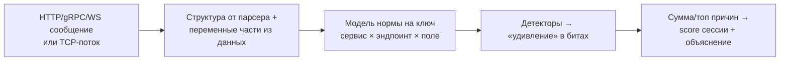
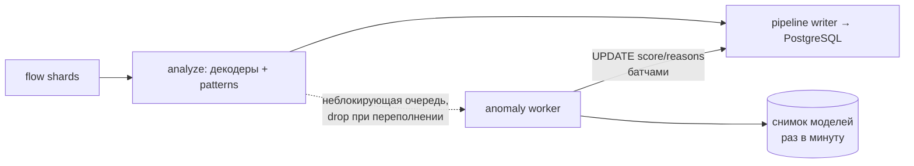

# Поиск аномалий в трафике без нейросетей: ресерч

Дата: 14 ноября 2026 года. Статус: первая версия реализована (см. §0), остальное — исследование и план.

## 0. Что реализовано

Вкладка **«Аномалии»** в UI и пакет `internal/anomaly`.

**Как подключено.** После успешной записи пачки в БД writer передаёт сохранённые части сессий детектору (`Writer.Observe`). Детектор работает в отдельной горутине. Очередь ограничена 32 МБ, при переполнении части отбрасываются и считаются в `drops`; захват и запись их не ждут. Результаты детектора с оценкой ≥ 6 бит пишутся в таблицу `gomate_anomalies` (одна строка на сессию, upsert раз в секунду, удаляется каскадом вместе с сессией).

**Что проверяется** (§3–4):

- структура из декодеров: путь, query, form, JSON, multipart, cookie, заголовки, статус ответа. Для текстового TCP и WebSocket без JSON — токены и сообщение целиком;
- шаблон пути по кардинальности (позиция с > 10 разными значениями становится `{*}`), без списка классов;
- новый или редкий эндпоинт; новое или редкое поле; пропавшие поля;
- символы (маска 32 групп байтов), форма значения, перечисления, длина. Признак считается нормальным, только если он встречался не меньше 10 раз и не реже 0,5% наблюдений, поэтому повторы одной атаки остаются видны;
- ответ сервера: статус, Content-Type, размер тела, набор JSON-ключей, `Set-Cookie`;
- кража флага (§4.8) без IP. Флаг определяется FIND-шаблоном, в названии или группе которого есть «flag» или «флаг». Сессия, где флаг пришёл в сервис, — закладка чекера. Сессия, которой флаг отдан, считается своей, если у неё с закладкой есть общий cookie/токен или хотя бы два общих значения запроса (логин и пароль); иначе это кража. Если флаг отдан раньше, чем обработана закладка, решение откладывается до неё.

**Обратная связь.** «Это норма» скрывает строку и добавляет её отличия в модель с весом ≈ 10% наблюдений поля, поэтому похожие сессии перестают всплывать. «Вернуть» показывает строку снова.

**Просмотр трафика.** Режим «Все сессии» по умолчанию показывает и привычный трафик, группируя сохранённые сессии на сервере по сервису, протоколу и методу/пути первого запроса без query. Тела и переменные сегменты пути здесь пока не кластеризуются. Оценки ниже 6 не сохранены: показывается «нет срабатывания», а не число 1. Очистка сессий уменьшает группы; обучение модели их не скрывает. Отдельно доступен прежний режим «Только аномалии». Реализация и проверки: [reports/ANOMALY.md](../reports/ANOMALY.md).

**API:** `GET /api/v2/anomalies?service=&minScore=&period=<сек>&sort=score|time&dismissed=1&limit=`, `GET /api/v2/anomalies/stats`, `POST /api/v2/anomalies/{streamId}/normal|restore`.

**Проверка.** Юнит-тесты в `internal/anomaly/engine_test.go`: SQLi/SSTI/CMDi, повтор атаки, `{*}` в пути, новый эндпоинт, traversal, mass assignment, enum, кража флага, флаг до закладки, текстовый TCP, обратная связь. Сквозной прогон на синтетическом pcap (500 пар закладка/проверка чекера с одного NAT-адреса и 15 атак 6 типов) дал 15 строк — все 15 атаки, ложных срабатываний нет; все 500 заборов флага чекером распознаны как свои. Бенчмарк: ~35 мкс на HTTP-сессию из 4 сообщений (≈ 9 мкс на сообщение, i7-12700F), из них ~20% — regex флага. На реальном трафике CTF ещё не проверялось.

**Ограничения текущей версии:**

- модель только в памяти: после перезапуска gomate прогрев начинается заново;
- нет марковских переходов между запросами сессии и подсчёта перебора id (§4.7), байтовых n-грамм (§4.6), diff со соседом (§3.3) и кластеров (§4.9);
- обучение идёт на всём трафике, а не на сессиях чекера (§6.1). Защита от «отравления» — только порог редкости и ручная кнопка «Это норма»;
- в HTTP/1 порядок заголовков недоступен: декодер сохраняет их отсортированными;
- для WebSocket и текстового TCP шаблон — первый токен сообщения, не больше 64 вариантов на сервис.

## 1. Задача

В attack-defense CTF большая часть трафика к сервису однотипна: чекер жюри и обычные клиенты регистрируются, логинятся, кладут и забирают данные. Сессии отличаются значениями: логины, пароли, cookie, токены, id, флаги. Эксплойты (SQLi, SSTI, path traversal, IDOR, обход авторизации, десериализация) — это запросы, которые **структурно или по содержимому отличаются от основного потока**, даже если ни одна сигнатура про них не знает.

Regex-поиск (FIND/IGNORE) в gomate уже есть. Нужно другое: «покажи сессии, которые не похожи на остальные, и объясни чем».

Ограничения:

- Без нейросетей и обучения градиентом. Только счётчики, гистограммы, скетчи, хэши и простые вероятностные модели. Всё считается онлайн, за O(размер сообщения).
- Лёгкий: бюджет — доли ядра и десятки МБ RAM на сервис; анализатор делит машину с игровыми сервисами (см. PLAN.md).
- Не блокирует захват. При перегрузке детектор может пропускать сообщения, захват — нет.
- Объяснимость. Оценка без причины бесполезна во время игры: оператору нужна строка вида «параметр `username` содержит символы `'()` — за 4 120 значений такого не было».
- Устойчивость к «отравлению»: атакующий трафик идёт с первых минут игры и после распространения эксплойта становится массовым.

## 2. Основная идея

Вся схема укладывается в четыре шага:



1. **Разделение структуры и значений** без ручного списка классов: структуру даёт парсер протокола, а какие места меняются от сессии к сессии (id, токены, флаги, креды), модель узнаёт сама по кардинальности и по diff между похожими сообщениями. После этого 10 000 сессий чекера сводятся к нескольким десяткам шаблонов.
2. **Модель нормы** — набор счётчиков на каждую пару (эндпоинт, поле): какие символы встречались, какой длины значения, какие ключи бывают, какие переходы между эндпоинтами.
3. **Детекторы** превращают отклонение в число бит удивления: `surprise = -log2 P(наблюдение | норма)`. Биты от разных признаков складываются (наивная байесовская модель независимых признаков), поэтому оценки сравнимы и итоговый score объясняется списком слагаемых.
4. **Ранжирование** выводит топ сессий за окно (раунд или N минут) с причинами. Абсолютные пороги не нужны.

Подход опирается на классические работы по аномалиям веб-запросов (Kruegel & Vigna, 2003/2005), payload-аномалиям (PAYL, Anagram) и майнингу шаблонов логов (Drain). Все они без нейросетей и работают в потоке.

## 3. Переменные части выводятся из данных, а не из списка классов

Заранее перечислить классы значений (UUID, JWT, hex, base64, ...) невозможно: у каждого сервиса свои форматы токенов, id и паролей, и любой пропущенный класс превращает каждую сессию в «уникальную». Поэтому ручной классификации значений нет. Модель сама узнаёт, какие части сообщения меняются от сессии к сессии, а всё, что о значении нужно знать, описывается **тотальными** признаками: они определены для любой последовательности байтов и не требуют знать её смысл.

Человек задаёт только regex флага (он уже есть в шаблонах gomate). Он нужен для §4.8, а не для нормализации.

### 3.1. Структура даёт парсер протокола, а не классификатор

Декодеры gomate уже выделяют в HTTP/gRPC/WS метод, путь, сегменты пути, ключи query/form, пути в JSON (`a.b[].c` + тип листа), имена multipart-частей, имена заголовков и cookie, статус ответа. Это синтаксис протокола, и он полный по построению. Значения остаются сырыми байтами.

Ключ модели — `(сервис, эндпоинт, место, имя поля)`, где место — `query | form | json | multipart | cookie | header | path[i] | slot` (`slot` описан в §3.3). Ответ сервера описывается так же: статус, Content-Type, длина тела, JSON-ключи, имена `Set-Cookie`.

### 3.2. Что переменное, а что константа — по кардинальности

Для каждой позиции (сегмент пути в дереве путей, поле, слот) считается:

- `n` — сколько раз встречено;
- `d` — число разных значений (HyperLogLog, 1–2 КБ, или точное множество хэшей до ~64 штук);
- `s` — число разных источников (сессий/клиентов) для каждого значения: top-K + count-min sketch.

По этим счётчикам позиция относится к одному из трёх видов:

| Вид | Условие (ориентир) | Пример | Что считается аномалией |
| --- | --- | --- | --- |
| константа | `d = 1` | `/api`, `Content-Type`, `action=login` | любое другое значение |
| перечисление | `d/n` мало и `d ≤ ~32` | `role=user`, `sort=asc`, метод | значение вне множества |
| переменная | `d/n` большое | логин, пароль, id, токен, флаг | см. §3.4: само значение не важно, важно, насколько оно «похоже на остальные значения этого поля» |

Шаблон пути строится без классов, как в **Drain**: позиция в дереве путей, где больше K (≈ 20) разных значений от разных сессий, становится `{*}`. `/note/123` и `/note/a8f3e9...` одинаково превращаются в `/note/{*}`, потому что в этой позиции много разных значений, а не потому что `123` — это `INT`.

Если у эндпоинта больше ~200 разных имён полей, имена сами являются данными: позиция `{key}` получает модель переменной (§3.4).

### 3.3. Слоты в неструктурированном содержимом: diff с соседом

Для того, что парсер не разбирает (текстовый TCP, тело с нестандартным форматом, строка внутри JSON-строки), переменные места находятся сравнением сообщений.

**Вариант A — токены и Drain.** Сообщение режется на токены по *любому* байту вне `[A-Za-z0-9]`, разделители сохраняются как токены. Это тотальное правило, классы не нужны. Drain группирует сообщения с одинаковым числом токенов и похожим префиксом. Позиции, где значения различаются у многих сессий, становятся `<*>`. Получаются шаблоны `PUT <*> <*>\n`, `LOGIN <*> <*>\n`, и у каждой `<*>` своя модель переменной.

**Вариант B — diff с ближайшим нормальным сообщением.** Для нового сообщения ищется самое похожее сообщение того же эндпоинта: MinHash/LSH по байтовым шинглам (§4.9) среди сохранённых прототипов, затем Myers diff (O(ND), с лимитом на длину, например 4 КБ). Различающиеся участки — переменные. Слот идентифицируется **якорем**: несколькими байтами константного текста слева (`username=`, `"token":"`, `GET /note/`). Статистики по слоту копятся по ключу `(эндпоинт, якорь)`. Это упрощённый вариант выравнивания, который используют инструменты вывода протоколов (Protocol Informatics, Netzob), и он работает для любого текстового формата.

Варианты дополняют друг друга. A дешевле и работает для строчных протоколов. B подходит для произвольных тел, но дороже, поэтому применяется только к сообщениям, которые не попали ни в один известный шаблон.

### 3.4. Как описать значение переменной без типа

Значение описывается признаками, которые определены для любых байтов:

- **маска групп байтов**: каждый из 256 байтов отнесён ровно к одной из 32 групп (§4.2), поэтому покрытие полное по построению;
- **длина** (в логарифмической шкале);
- **энтропия на символ** (Шеннон по байтам значения);
- **форма**: последовательность групп со сжатием повторов (`user_123` → `a_9`, `1' OR '1'='1` → `9' A '9'='9`), ограниченная, например, 16 элементами;
- **n-граммы групп** (не байтов): тройки групп, а не тройки байтов.

Случайные значения узнаются по статистике, а не по классу. Поле, где почти все значения разные, маска стабильна, длина в узком диапазоне, энтропия высокая — это «случайный токен», какого бы формата он ни был: UUID, JWT, собственный формат сервиса. Новый формат токена у чекера модель просто выучит. Инъекция в такое поле выделяется сразу по нескольким признакам: новые группы в маске, другая форма, обычно и другая длина/энтропия.

Почему n-граммы групп, а не байтов: у случайных значений байтовые n-граммы почти все новые, и байтовая модель на переменных полях даёт сплошные ложные срабатывания. У n-грамм групп словарь маленький (32³ ≈ 32 тыс.), и у нормальных значений он быстро насыщается. Байтовые n-граммы (§4.6) применяются только там, где у n-грамм высокая *документная частота*, т.е. они встречаются во многих разных сессиях (константный текст, свободный текст на естественном языке). n-грамма, встреченная в одной сессии, в норму не попадает и при оценке не учитывается: так случайные части отсекаются без знания их формата.

## 4. Детекторы

Каждый детектор хранит небольшую модель на ключ из §3.1 и возвращает 0 или больше «причин» с числом бит. Ниже они упорядочены по отношению пользы к стоимости.

### 4.1. Новизна и редкость шаблона

Счётчик `c(template)` и общее `n` за окно. Удивление со сглаживанием:

```
surprise = -log2((c + α) / (n + α·K))        α ≈ 0.5, K — число шаблонов
```

Новый шаблон после прогрева — сильный сигнал: эндпоинт, который чекер не трогает (админка, debug-ручка, `/../`, необычный метод вроде `PUT` на GET-ручку). Дешёво: хэш-таблица или count-min sketch.

### 4.2. Алфавит поля (маска групп байтов)

На ключ поля — 32-битная маска «какие группы символов встречались» и счётчик на каждый бит. Группы подобраны под инъекции:

```
a-z  A-Z  0-9  space  '  "  `  < >  { }  ( )  [ ]  ;  | &  $  \  /  .  ..  %  #  =  ,  :  *  !  @  ~  ^  +  -_  \n\r\t  <0x20/0x7f  non-ASCII
```

Если поле видело `n` значений и ни в одном не было бита `b`, а новое значение его содержит, то по «правилу трёх» `P(b) ≲ 3/n`, удивление ≈ `log2(n/3)` бит. При `n = 4000` это ~10 бит на каждую новую группу.

Ловит почти все инъекции в поля с узким алфавитом: SQLi (`'`, `(`, `-`, пробел), SSTI (`{`, `}`), command injection (`;`, `|`, `$`, `` ` ``), traversal (`..`, `/`), XSS (`<`, `>`), NoSQL (`$`, `[`). Стоимость — один проход по байтам и OR.

Это упрощение модели «character distribution» из Kruegel & Vigna: вместо χ²-теста по распределению — множество встреченных групп. На CTF-трафике этого обычно достаточно, а объяснение прозрачное.

### 4.3. Форма и перечисления

На ключ поля хранится:

- распределение энтропии и доля значений, состоящих из одной группы (например, только цифры). Поле, где значения всегда из цифр, а пришло значение с буквами, даёт удивление, и для этого не нужен класс `INT`;
- top-N форм (N ≈ 16) со счётчиками и `other`;
- **детектор перечислений** (token finder у Kruegel, §3.2): если число разных значений растёт медленно (`distinct/n` < 0.05 при n ≥ 100), поле считается enum (`role=user`, `sort=asc`). Новое значение — сильная аномалия (`role=admin`, `sort=id;DROP`).

### 4.4. Длина значения

Длину логарифмируем, затем считаем робастную статистику: медиану и MAD по скользящему резервуару или онлайн-оценке P² квантилей. Оценка — `|log(len) - median| / MAD`, переводится в биты через неравенство Чебышёва, как у Kruegel (оно не требует предположений о распределении).

Ловит переполнения, длинные payload-цепочки, пустые значения там, где их не бывает. Отдельно — длина **ответа** на шаблон: IDOR и дамп таблицы видны как ответ в 50 раз длиннее обычного.

### 4.5. Структура полей

На шаблон хранятся:

- частота присутствия каждого поля: обязательные поля (≥ 99%) отсутствуют → аномалия, неизвестное поле появилось → аномалия. Типичный mass assignment: `{"login":..,"password":..,"is_admin":true}`;
- порядок полей и заголовков как хэш последовательности (top-N + счётчик). Чекер и `requests`/`curl`/руками написанный сокет дают разный порядок. Это слабый признак, полезный для кластеризации, а не для алерта;
- дубли параметров (`?id=1&id=2`), смешение JSON и form, `Content-Type` не соответствует телу.

### 4.6. n-граммы содержимого (Anagram)

Для свободного текста (комментарии, заметки, описания), где алфавит широкий и §4.2 молчит:

- на ключ поля — Bloom-фильтр байтовых n-грамм (n = 3…5) из нормального трафика;
- оценка нового значения — доля n-грамм, которых нет в фильтре.

Так работает **Anagram** (Wang, Parekh, Stolfo, 2006). Фильтр на 64 КБ держит десятки тысяч n-грамм с низкой долей ложных срабатываний. Вариант без фильтра — **PAYL** (Wang & Stolfo, 2004): частоты 256 байт по корзинам длины и упрощённое расстояние Махаланобиса. Он грубее, зато хорош для бинарных протоколов.

### 4.7. Поведение сессии (последовательность запросов)

Сессию в HTTP собираем по ключу: значение `Cookie`/`Authorization` → связь через `Set-Cookie` из предыдущего ответа → в крайнем случае TCP-соединение (keep-alive). IP клиента для этого не используется: в игровой сети обычно включён маскарадинг, и весь входящий трафик, включая чекер, приходит с одного адреса. Порт клиента различает соединения, но не участников.

- **Марковская цепь первого порядка** по шаблонам: `P(next | prev)` со сглаживанием, плюс распределение «первого запроса сессии». Чекер ходит `register → login → put → get`. Эксплойт сразу дёргает `GET /note/{*}` без логина, логинится и читает чужой объект или повторяет `get` 300 раз с разными id. Удивление пути — сумма `-log2 P` по переходам, нормированная на длину.
- **Перебор**: на (клиент, шаблон) — HyperLogLog числа разных значений переменной (`{*}` в пути, `id` в query) за окно. Чекер читает 1–2 своих объекта, IDOR-эксплойт — сотни.
- Темп: число запросов на сессию/клиента за окно относительно медианы.

### 4.8. Происхождение флагов (самый сильный сигнал для A/D)

Это не аномалия в строгом смысле, но использует тот же механизм и даёт почти нулевую долю ложных срабатываний:

IP при этом не нужен, потому что из-за маскарадинга он ничего не говорит. Чекер узнаётся по поведению: только он **кладёт** валидные флаги.

1. Флаг входит в сервис (incoming) → эта сессия считается **put-сессией чекера**. Запоминаем `flag → (stream, креды, cookie/токены, id созданных объектов)`; id и токены берутся из ответа сервиса в той же сессии. Хватит LRU на несколько раундов.
2. Флаг уходит из сервиса (outgoing). Если сессия связана с put-сессией (тот же логин, тот же токен или cookie, выданный при put), это **get чекера**, и сессия тоже помечается как чекер. Если не связана — **кража**, score максимальный.
3. Запрос, который получил флаг, — пример эксплойта. Его шаблон и признаки (новые биты маски, форма) добавляются в «подозрительный профиль». Все сессии с тем же отклонением поднимаются наверх, даже если флага в ответе нет (например, эксплойт сработал против уже пропатченного сервиса).

Regex флага в gomate уже задаётся шаблоном. Нужны только направление и источник совпадения, оба уже известны в `analyze`.

### 4.9. Кластеризация сессий: «одиночки»

Для оператора полезен вид «сгруппируй похожее, покажи маленькие группы»:

- отпечаток сессии — множество токенов: `шаблон`, `шаблон.поле:форма`, `биты маски`, `статус ответа`;
- **MinHash** (64–128 хэшей) + LSH-бандинг дают кластеры почти похожих сессий за O(1) на вставку. **SimHash** (64 бита) с расстоянием Хэмминга ≤ 3–6 проще и тоже подходит;
- размер кластера — сам по себе оценка: кластер из 1–3 сессий среди тысяч = аномалия. Кластер, где есть кража флага, помечается целиком.

Для текстовых TCP-протоколов без структуры есть запасной вариант — **NCD**, нормализованное расстояние сжатия (Cilibrasi & Vitányi, 2005): `NCD(x,y) = (C(xy) − min(C(x),C(y))) / max(C(x),C(y))` с zstd против 3–5 прототипов кластера. Дороже, поэтому только для потоков, не попавших в известный шаблон.

### 4.10. Ответ сервера

Аномалии в ответе часто надёжнее, чем в запросе, потому что запрос можно обфусцировать, а «сервис ответил необычно» скрыть трудно:

- статус, не типичный для шаблона (500 на ручке, где всегда 200, — сломанная инъекция или удачный фаззинг);
- маркеры ошибок СУБД и стектрейсы. Это regex, но его можно включить как признак в score;
- длина ответа (§4.4) и число элементов JSON-массива;
- новые JSON-ключи в ответе (утечка `password_hash`, `is_admin`).

### Сводная таблица

| Детектор | Что ловит | Память на ключ | CPU | Риск ложных срабатываний |
| --- | --- | --- | --- | --- |
| 4.1 Новый/редкий шаблон | скрытые ручки, нестандартные методы, traversal в пути | 8–16 Б | O(1) | средний на старте, низкий после прогрева |
| 4.2 Маска алфавита | SQLi, SSTI, CMDi, XSS, traversal в полях | ~130 Б | O(len) | низкий |
| 4.3 Тип/форма/enum | подмена типов, `role=admin`, NoSQL-операторы | ~1 КБ | O(len) | низкий |
| 4.4 Длина | переполнения, дампы, IDOR в ответе | ~200 Б | O(1) | средний |
| 4.5 Структура | mass assignment, лишние или пропущенные поля, «не тот клиент» | ~1 КБ | O(полей) | низкий/средний |
| 4.6 n-граммы | инъекции в свободный текст | 16–64 КБ | O(len) | средний |
| 4.7 Сессия | IDOR, обход логина, перебор | ~2 КБ на шаблон + HLL на клиента | O(1) | средний |
| 4.8 Флаги | факт кражи | LRU флагов | O(1) | очень низкий |
| 4.9 Кластеры | «необычные» сессии целиком | 0.5–1 КБ на сессию в окне | O(k) | средний |
| 4.10 Ответ | успешная эксплуатация, ошибки | как 4.3–4.5 | O(len) | низкий/средний |

## 5. Комбинирование оценок

- Каждая причина несёт `bits`. Score сообщения — сумма бит, ограниченная на причину (например, ≤ 20 бит), чтобы одна причина не перекрывала всё остальное. Score сессии — максимум по сообщениям плюс поведенческие причины (§4.7), с бонусом за флаги (§4.8).
- Причины, у ключа которых мало данных (`n < n_min`, ~30–50), не учитываются и помечаются «мало данных». Так модель не кричит о каждом поле в первые минуты.
- Выводится **ранг** внутри сервиса за окно (топ-20, перцентиль), а не абсолютный порог. Распределение score у разных сервисов разное.
- Альтернатива сумме — HBOS (Goldstein & Dengel, 2012): по гистограмме на признак и сумма `log(1/плотность)`. Это та же идея в другой форме.

Пример результата для оператора:

```
#81234  score 37.4  svc notes:8080  POST /api/login
  +12.1  form.username: новые символы ' ( )  (n=4120, раньше: a-z 0-9 _)
  + 9.8  form.username: форма "a' A a('9')" не встречалась (top: "a9", "a_9")
  + 6.0  response.status 500 на шаблоне, где 99.7% — 200
  + 9.5  кластер размером 2 из 3 840 сессий за раунд
```

## 6. Модель нормы во времени и защита от отравления

Главная практическая проблема: в A/D нет «чистого» периода, атакующие активны с первых минут, а через час эксплойт гоняют 30 команд, и по частоте он становится «нормой».

Что делать:

1. **Учить норму на трафике чекера, найденном по поведению.** По IP чекер не отличить: из-за маскарадинга все приходят с одного адреса. Зато его можно найти так:
   - **по флагам** (§4.8): put-сессии, где флаг входит в сервис, и get-сессии, связанные с ними кредами или токенами;
   - **по отпечатку клиента**, выученному на этих сессиях: набор и порядок заголовков, `User-Agent`, регистр имён заголовков, `Accept-Encoding`, параметры TCP SYN (окно, MSS, порядок TCP-опций, window scale, TTL). Маскарадинг меняет адрес и порт, но не HTTP-клиент и обычно не TCP-опции, поэтому эти признаки остаются отпечатком исходной машины (идея p0f). Сессии с тем же отпечатком, например check-сессии без флагов, получают метку «вероятно чекер» с меньшим весом;
   - **по ритму раунда**: чекер приходит пачкой в начале раунда к каждому сервису с одинаковым набором действий.

   Норма строится по сессиям с меткой чекера или с большим весом для них. Это самая важная мера: модель становится «полуконтролируемой» без всякого ML. Если чекер научится маскироваться под атакующих (случайный UA), остаются флаги, а это надёжная метка.
2. **Консенсус сессий** для остального трафика: значение/форма/n-грамма считается нормальной, только если встречена в ≥ k разных сессиях (с разными кредами) **и** за ≥ 2 раунда. Разные IP здесь не годятся, потому что адрес у всех один. Это защищает от одного шумного скрипта, но не от эксплойта, который запустили все команды; от этого спасают только п. 1 и п. 3.
3. **Заморозка после прогрева.** Первые N раундов модель учится, потом обновляется только трафиком жюри. Остальной трафик лишь оценивается.
4. **Два окна вместо одного.** Модель «предыдущее окно» + «текущее окно», ротация каждый раунд (или экспоненциальное затухание счётчиков с полупериодом в несколько раундов). Это учитывает патчи сервисов: после своего фикса трафик меняется, и старая норма должна отмирать.
5. **Ручная обратная связь.** Кнопка «это нормально» добавляет признак в allowlist модели ключа. Кнопка «это атака» сохраняет отпечаток (§4.9) как профиль и подсвечивает похожие сессии. Без такой связи доля ложных срабатываний в первые раунды будет мешать.
6. **Робастная статистика.** Медиана/MAD и квантили, а не среднее/дисперсия: несколько огромных значений не должны сдвигать норму.

## 7. Как встроить в gomate

### 7.1. Где в конвейере



- Новый пакет `internal/anomaly`: вывод структуры и переменных частей (§3), модели (§4), скоринг (§5).
- Вход — уже декодированные `model.Packet` с `Kind`/`Metadata` из `internal/analyze/protocol.go`. HTTP/gRPC/WS повторно разбирать не нужно.
- Отдельный worker (или по одному на сервис), неблокирующая ограниченная очередь со счётчиком `anomaly_drops_total`. Это соответствует принципу проекта: capture не ждёт никого.
- Модели живут в памяти по сервисам. Снимок раз в минуту сохраняется в `gomate_anomaly_models (service, data bytea)`: gob/msgpack со счётчиками и битсетами, поэтому рестарт не обнуляет прогрев.
- Для старых сессий нужен пересчёт по образцу lookback-job: прогнать сохранённые пакеты через модель с checkpoint.

### 7.2. Хранение и API

```sql
ALTER TABLE gomate_streams ADD COLUMN IF NOT EXISTS anomaly_score real;
ALTER TABLE gomate_streams ADD COLUMN IF NOT EXISTS anomaly jsonb;   -- [{bits, detector, key, text}], top-5
ALTER TABLE gomate_streams ADD COLUMN IF NOT EXISTS anomaly_cluster bigint;
CREATE INDEX IF NOT EXISTS gomate_stream_anomaly
  ON gomate_streams (service, anomaly_score DESC) WHERE NOT ignored AND anomaly_score IS NOT NULL;
```

- API: страница сессий с сортировкой по `anomaly_score` за окно; `GET /api/anomaly/stream/{id}` с причинами; `POST /api/anomaly/feedback` (normal/attack).
- UI: колонка/бейдж score в списке, причины в карточке сессии, фильтр «топ аномалий за раунд», кнопка «похожие» (тот же `anomaly_cluster`). Совместимость с текущим UI можно получить дёшево, если выдавать топ-аномалии как виртуальный шаблон, чтобы существующий фильтр по шаблону работал сразу.

### 7.3. Бюджет

Ориентир: ≤ 5–10 мкс на HTTP-сообщение для детекторов 4.1–4.5 и 4.8 (проход по байтам, хэши, мапы), 4.6 и 4.9 — ещё единицы микросекунд. При 2–5 тыс. сообщений/с это меньше 5% одного ядра. Память: сотни шаблонов × десятки полей × ~2 КБ ≈ единицы МБ на сервис, плюс Bloom-фильтры 4.6 (ограничить общим бюджетом, например 32 МБ, с LRU по ключам). Цифры — оценки, их нужно подтвердить бенчмарком в `bench/`.

## 8. План реализации по шагам

**MVP-1 (основная ценность):**
1. Структура из декодеров (query/form/JSON/cookie/заголовки), кардинальность позиций и шаблон пути по Drain (§3.2), тотальные признаки значений (§3.4).
2. Детекторы 4.1, 4.2, 4.3, 4.4 на запрос и ответ.
3. Происхождение флагов 4.8 и метка «чекер» по флагам и связанным кредам (без IP).
4. Score + причины в `gomate_streams`, сортировка в UI.

**MVP-2:**
5. Сессии и марковские переходы, HLL-перебор (4.7).
6. Структура полей 4.5, n-граммы 4.6 для свободного текста.
7. Обратная связь normal/attack, заморозка и два окна (§6).

**MVP-3:**
8. MinHash/SimHash-кластеры и «одиночки» (4.9), кнопка «похожие».
9. Слоты в неструктурированном содержимом: Drain для текстовых TCP-протоколов, diff с соседом (§3.3), PAYL для бинарных.
10. Пересчёт исторических сессий.

## 9. Как проверять

- **Синтетический стенд** в `bench/traffic`: генератор «чекера» (register → login → put → get со случайными кредами и флагами) с примесью 0.1–1% атак: SQLi, SSTI, traversal, IDOR-перебор, mass assignment, вход без логина, плюс «шумные, но честные» клиенты (другой UA, другой порядок). Метрики: precision@20 за окно, доля атак в топ-1%, время до первого попадания атаки в топ.
- **Отравление:** сценарий, где через 30 минут эксплойт гоняют 50% клиентов. Проверить, что при обучении только на сессиях, помеченных как чекер (§6.1), он остаётся в топе. Весь трафик генератора идёт с одного IP, как при маскарадинге.
- **Патч сервиса:** смена формата ответа посреди игры. Проверить, что затухание (§6.4) снимает ложные срабатывания за 1–2 раунда.
- **Реальные pcap** прошлых игр (свои дампы или публичные). Прогнать через `PCAP_FILE` и вручную разметить топ-50.
- Нагрузочный бенчмарк детекторов: мкс на сообщение и память на сервис при росте числа шаблонов и полей.

## 10. Что сознательно не берём

- **Ручной список классов значений** (UUID, JWT, hex, ...). Все форматы не перечислить; переменные части выводятся из данных (§3).
- **Нейросети и эмбеддинги** — по условию задачи. Кроме того, их трудно объяснить и долго прогревать.
- **Isolation Forest / One-Class SVM** — это не нейросети, но они требуют векторизации признаков, переобучения и дают плохо объяснимый score. Сумма бит по детекторам из §4 даёт то же ранжирование и при этом объясняется.
- **Полный χ²/Махаланобис по распределению символов** для каждого поля. Маска групп (§4.2) + n-граммы (§4.6) проще и на практике не хуже для CTF-полей.
- **TLS.** Без расшифровки остаются только метаданные (размеры, тайминги, SNI, JA3-подобный отпечаток ClientHello). Это можно добавить позже как отдельный слабый детектор.

## 11. Источники и прототипы

- C. Kruegel, G. Vigna. *Anomaly Detection of Web-based Attacks.* ACM CCS 2003. Модели длины атрибутов, распределения символов, структурного вывода, token finder, присутствия и порядка атрибутов — прямой прототип §4.2–4.5.
- M. Beddoe. *Protocol Informatics* (2004) и проект Netzob: вывод формата протокола выравниванием сообщений — прототип §3.3.
- C. Kruegel, G. Vigna, W. Robertson. *A multi-model approach to the detection of web-based attacks.* Computer Networks, 2005. Расширенная версия, комбинирование моделей.
- K. Wang, S. Stolfo. *Anomalous Payload-based Network Intrusion Detection (PAYL).* RAID 2004. Распределение байтов по длинам.
- K. Wang, J. Parekh, S. Stolfo. *Anagram: A Content Anomaly Detector Resistant to Mimicry Attack.* RAID 2006. n-граммы в Bloom-фильтре.
- P. He, J. Zhu, Z. Zheng, M. Lyu. *Drain: An Online Log Parsing Approach with Fixed Depth Tree.* ICWS 2017. Онлайн-вывод шаблонов (реализация: Drain3).
- M. Charikar. *Similarity Estimation Techniques from Rounding Algorithms.* STOC 2002 (SimHash). A. Broder. *On the resemblance and containment of documents.* 1997 (MinHash).
- G. Cormode, S. Muthukrishnan. *An improved data stream summary: the count-min sketch.* 2005. P. Flajolet et al. *HyperLogLog.* 2007.
- M. Goldstein, A. Dengel. *Histogram-based Outlier Score (HBOS).* KI 2012.
- R. Cilibrasi, P. Vitányi. *Clustering by Compression.* IEEE Trans. Inf. Theory, 2005 (NCD).
- CTF-инструменты для сравнения UX: Tulip (теги flag-in/flag-out, поиск похожих потоков), Caronte, Shovel, Flower.
